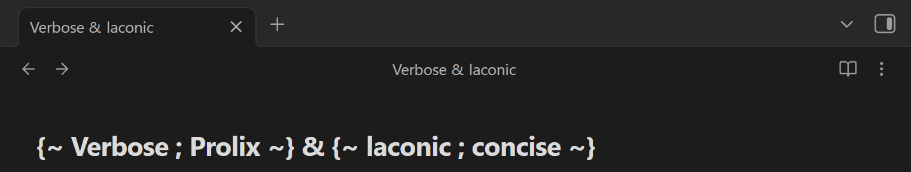
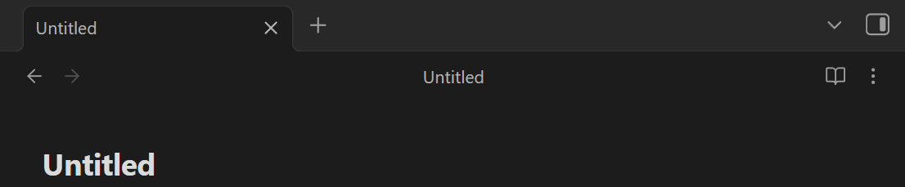
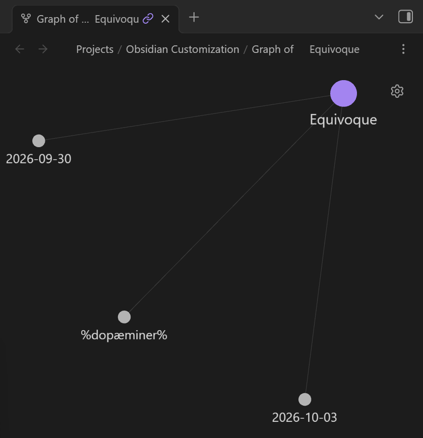
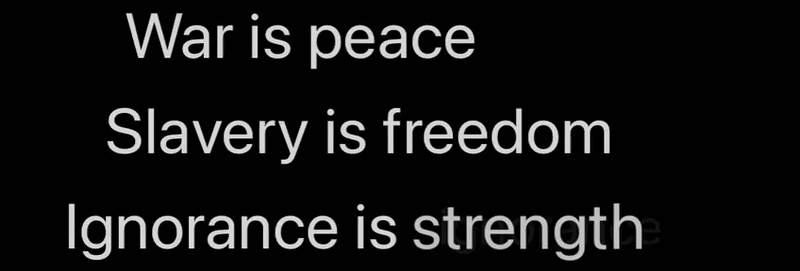
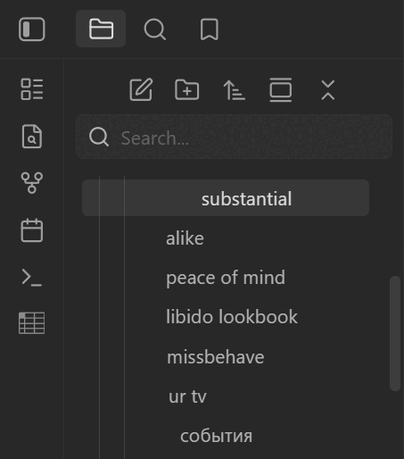

# Metamorpheme

Align your means of expression within expanded limitations



### Use it when

- **You write with layered meaning.** Poetry, fiction and worldbuilding often depend on words that mean two things at once. Show both readings in the same place.
- **A concept has no single name.** Title a note with the several words that each capture part of it, whether a feeling, a theme or a half-formed idea, so the note carries all of them instead of forcing you to pick one.
- **You’re choosing between words.** Keep candidate names for a project, chapter or character cycling in the title while you decide, or keep near-synonyms side by side while editing a sentence.
- **Words don’t translate cleanly.** Show a term in two or three languages together, or a word next to its closest equivalents, for language learning, translation work or multilingual notes.
- **A term means different things in different contexts.** In a glossary or study notes, let one entry show its senses (say, a word in physics and in everyday speech) instead of a single definition that hides the rest.


> Linguistically, we like to think words have strict definitions. But in actual communication, words function exactly like clouds of states. They exist in superposition until context forces them to resolve.




One node ≠ one name. See the point ?



Preserve unique markdown per morpheme or wrap the whole metamorpheme in one


Superpose meanings that coincide. Equivocal by design.



Let them brain wave functions flow w/0 collapse w one tap of the button at your fingertips among tooltips 


Explore wider range of meanings at glance



## Syntax

```
{~ $ @2%1 < crossfade $ Leave ; Make @1.5%0.4 ; Find @3 ~} space for what one word couldn't carry.
```

- `{~ $ @H%F >< zoom $ morpheme @H ; morpheme @H%F ; morpheme @%F ; … ~}` — space after `{~` and before `~}`; first morpheme starts after `{~`, or after `$ $` when present; morphemes separated by the configured separator (default `;`).
- Optional `$ $` at the start overrides default plugin settings for this set. `@H` is hold: seconds a morpheme stays fully visible before the next transition starts. `@%F` is fade: seconds that transition takes. `@H%F` sets both. Alignment is `><` / `center`, `<>` / `justify`, `<` / `left`, `>` / `right`. Style is the name (`zoom`, `diffuse`, `slide`, `crossfade`).
- `morpheme @H` — this morpheme stays H seconds before the transition into the next one starts.
- `morpheme @H%F` — same, and the transition into the next morpheme takes F seconds.
- `morpheme @%F` — only override the transition duration.

